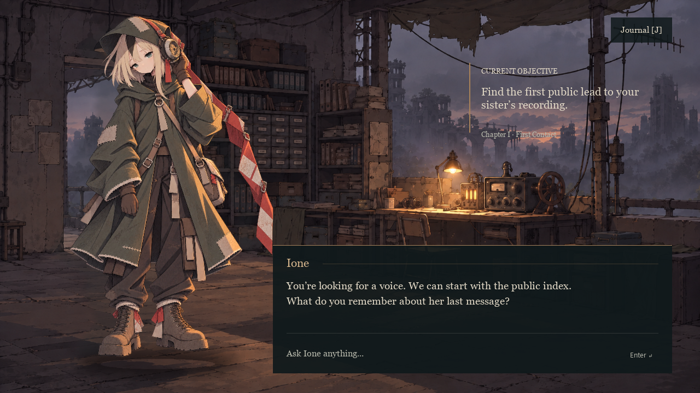

# Ione | Unreal Engine 5 NPC Agent

Ione is a playable game NPC prototype set in a flooded wasteland archive. Players type to Ione in an Unreal Engine 5 dialogue window. A local Agent checks the game world and permissions, then returns a grounded reply and a matching character pose. The scene includes a hand-drawn-style background, a full-body character and an in-game dialogue panel.



## Run

1. Install **Unreal Engine 5.8.4**, **Python 3** and [Ollama](https://ollama.com/). In a terminal, run `ollama pull qwen3:1.7b` and `ollama pull gemma3:4b`.
2. From the repository root, start the local Agent bridge:

   ```powershell
   python .\Tools\serve_ione_agent.py
   ```

3. Open `AsterPerformanceLab.uproject` in Unreal Engine, load `L_IoneStage`, and press **Play**. Click the dialogue box, type a question, and press **Enter**.

Try `东桥还能走吗？`, `红账本是谁的？`, or `打开档案室的门`. Ione checks routes and records against game tools; opening the archive door requires consent.

Press **J** to open the Journal and **Esc** to close it. The screen uses the selected full-body illustration with 2D speaking, interruption and warning motion. Typography uses Georgia from Windows, with a built-in fallback when unavailable.

The Agent bridge is in [`Tools/serve_ione_agent.py`](Tools/serve_ione_agent.py); the game runtime is in [`Plugins/AsterPerformanceRuntime/`](Plugins/AsterPerformanceRuntime/). Run `python -m pytest -q` for the Python tests.

Session progress is saved locally in `Saved/ione_sessions.sqlite3`. The current UE client uses the default session. API clients can create an isolated session with `POST /session/new`, pass its `session_id` alongside `text` and `turn_id` to `POST /turn`, and resume it with `GET /session/{id}`. Keep the database when restarting the bridge; back it up before a database upgrade. Unsupported schema versions fail explicitly.

The session API also accepts structured game actions through the optional `action` field, such as `find_public_lead`, `inspect_relay` or `repair_relay`. Quest prerequisites and tool permissions validate each action. The response includes the current objective, quest events and Journal updates. These story actions are available through the API; the existing UE screen currently displays dialogue and poses.
