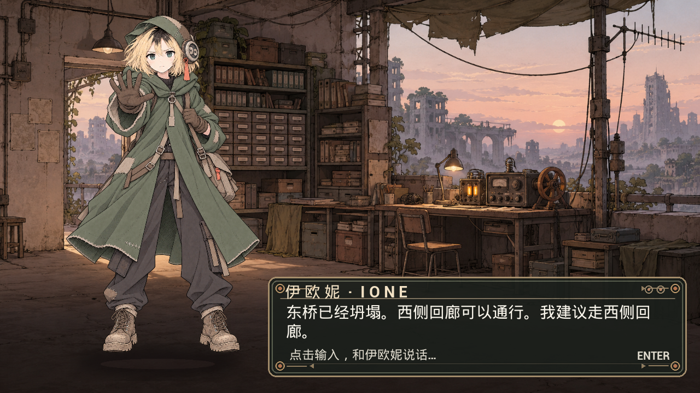

# Ione | Unreal Engine 5 NPC Agent

Ione is a playable game NPC prototype set in a flooded wasteland archive. Players type to Ione in an Unreal Engine 5 dialogue window. A local Agent checks the game world and permissions, then returns a grounded reply and a matching character pose. The scene includes a hand-drawn background, a full-body character and an in-game dialogue panel.



## Run

1. Install **Unreal Engine 5.8.4**, **Python 3** and [Ollama](https://ollama.com/). In a terminal, run `ollama pull qwen3:1.7b` and `ollama pull gemma3:4b`.
2. From the repository root, start the local Agent bridge:

   ```powershell
   python .\Tools\serve_ione_agent.py
   ```

3. Open `AsterPerformanceLab.uproject` in Unreal Engine, load `L_IoneStage`, and press **Play**. Click the dialogue box, type a question, and press **Enter**.

Try `东桥还能走吗？`, `红账本是谁的？`, or `打开档案室的门`. Ione checks routes and records against game tools; opening the archive door requires consent.

The [experiment report](Reports/fast_agent_findings.md) contains the baseline comparison and raw traces. The [UE run record](Reports/ue5_ione_live/README.md) contains more screenshots and the five-case integration check. Source code for the bridge is in [`Tools/serve_ione_agent.py`](Tools/serve_ione_agent.py); the game runtime is in [`Plugins/AsterPerformanceRuntime/`](Plugins/AsterPerformanceRuntime/).
