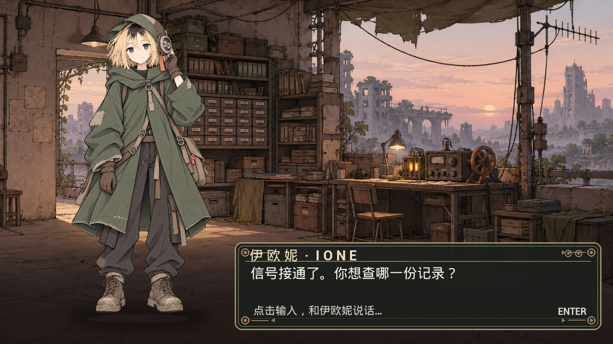
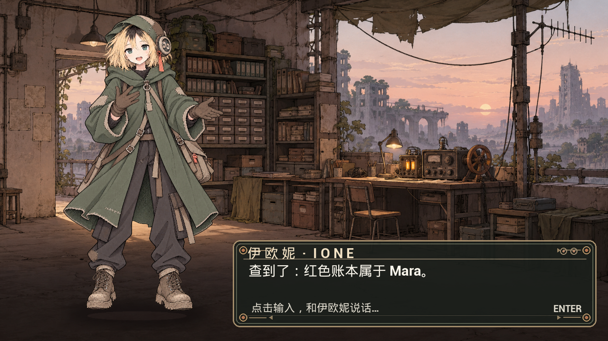

# Ione: live Unreal dialogue and pose integration

Verified on 2026-10-28 with Unreal Engine 5.8.4 (Windows, D3D11), Python loopback service, and local Ollama. These images are **UE game-viewport screenshots**, captured after typing in the actual UMG dialogue input. They are not composited mockups.

| Player request | Game tool result | Visible response |
|---|---|---|
| `东桥还能走吗？` | East bridge `collapsed`; alternative west gallery `open` | Grounded route advice and warning pose |
| `红账本是谁的？` | `lookup_record(owner_note) → Mara` | Grounded answer and speaking pose |
| `打开档案室的门` | `consent_required`; `archive_door` remains `locked` | Refusal and warning pose, verified in running game and bridge |
| `不要打开档案室` | No tool call | Listening pose; no world change |

## Reproduce

1. Start Ollama with `qwen3:1.7b` available. The local model is used for unfamiliar intent wording. Clear commands are handled by a deterministic policy.
2. From the repository root, run `python Tools/serve_ione_agent.py`. The service binds only to `127.0.0.1:8765`.
3. Open `AsterPerformanceLab.uproject` in UE 5.8.4, Play `L_IoneStage`, click the ornate input line, type a question, and press Enter. The UE HTTP client sends `{text, turn_id}` and applies the returned tool-grounded dialogue and pose. A serial check drops an older reply after a newer request.
4. Run `python Tools/eval_live_bridge.py` for the five-case bridge check. Raw responses, including tool traces, world state and service timing, are in [`bridge_smoke.json`](bridge_smoke.json).
5. Run `python Tools/eval_bridge_interrupt.py` for a concurrent-turn check. A slower model-routed route question was superseded by a new record question: the older call returned HTTP `409 stale_turn`, and the newer call returned HTTP `200` with the verified `Mara` record. Raw responses are in [`interrupt_smoke.json`](interrupt_smoke.json).

The five-case check passed 5/5 after the scene integration. It is an integration smoke test on author-written prompts. The measured `latency_ms` field covers **only the Python service request**, not player input, UE rendering or a cold model start. These five prompts took a policy path; they must not be cited as model inference latency. A separate free-form English query did reach the small-model path (route intent, two verified route tools, 11.26 s on this machine). An unrecognized Chinese paraphrase previously escalated to a large router and took 33.91 s; a narrow, explicit route synonym was subsequently added, but open-ended Chinese language coverage remains limited. The [ten-case offline comparison](../fast_agent_findings.md) is the source for the baseline-to-improved 17.21 s → 0.62 s P50 and 8/10 → 10/10 task results.

## Implementation boundary

The scene currently swaps four authored full-body 2D poses and adds a short positional/rotational accent. Tool results also create a transient UI cue and a Blueprint action event **only after a verified success**. This is a functioning dialogue-to-pose prototype, not a skeletal animation rig or lip-synced character. No world-object animation is bound to the event yet; the consent denial changes no door state. Backend supersession was verified with concurrent requests, and the UE client guards responses by serial number and calls `PlayerInterrupt`; an overlapping **UE-window** sequence was not captured. These limits should remain explicit in a CV or HR demo.
